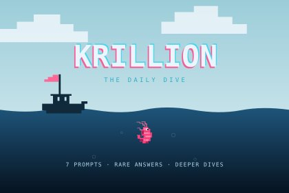

# Krillion — Cubes 2048

[Play Krillion](https://cubes-2048.io/games/krillion) · [Website: cubes-2048.io](https://cubes-2048.io) · [简体中文](README.zh-CN.md)

**Krillion** is a browser trivia game about finding uncommon answers. Play seven
timed rounds, explore a pixel ocean, and try the daily dive, unlimited practice
or six themed challenges. This repository contains the standalone React/TypeScript
game, question bank, artwork, build tools and tests from
[Cubes 2048](https://cubes-2048.io). No account, database or API key is required.

[](https://cubes-2048.io/games/krillion)

Play online: [English](https://cubes-2048.io/games/krillion) ·
[简体中文](https://cubes-2048.io/zh/games/krillion).

## Run locally

Use Node.js 22 or newer and pnpm 10.15.0.

```sh
git clone https://github.com/ailingqu/krillion-game.git
cd krillion-game
corepack enable
pnpm install --frozen-lockfile
pnpm dev
```

Open [localhost:4173](http://localhost:4173) and choose a language, or visit
`/games/krillion/` directly. Add `?lang=zh` for Chinese or `?mode=unlimited` to
start unlimited practice immediately. Progress stays in the current browser and
origin; it is not synced between devices and is removed when site data is cleared.

The preview server listens on `127.0.0.1` and serves only `public/`.
Use `PORT=4174 pnpm preview` to change its port. Rebuild after source changes;
this standalone setup does not provide hot reload.

## Gameplay and data

- 2,836 prompts across 55 categories, including letter and word-length variants.
- Seven rounds per game, with 25 seconds per round.
- Fixed answer scores, up to 700 points / 7,000 meters per game; scores are not
  calculated from live player answer frequency.
- Daily challenges change at 00:00 UTC. Unlimited practice and six themed packs
  are also available.
- English and Simplified Chinese interface, saved dives and shareable challenges.

The question bank is compiled from the included `categories.txt`. This is an
independently maintained Cubes 2048 edition, not the original game's official
repository. Questions, scoring and browser saves are independent; no original-game
API is called. [Mechanics reference](https://krillion.io/). The code license does
not grant rights to third-party names or trademarks.

## Build and verify

```sh
pnpm typecheck
pnpm test
pnpm build
pnpm preview
```

Tests build the game and check the question bank, scoring, timers, save/restore,
challenge links, standalone assets and preview server. `public/` contains the
static launcher, `/games/krillion/` and license notices. Serve that directory at
a domain root so the game paths and sharing links work. No hosting or deployment
automation is configured.

`.game-previews/krillion-preview.html` is a portable HTML with its question bank,
scripts, styles, font and license notices embedded. Generated files are ignored
by Git. The game HTML retains `noindex` and a canonical link to its Cubes 2048
page; review those settings if publishing a separately branded site.

## Source map

| Path | Purpose |
| --- | --- |
| `lib/games/krillion/` | Trivia engine, UI, source question bank, artwork and font |
| `scripts/` | Static build, license collection and local preview server |
| `web/` | Game launcher |
| `tests/` | Game, build and server checks |

## Contributing and license

Use `dev` for changes and `main` for reviewed releases. Run `pnpm typecheck` and
`pnpm test` before submitting a change. Report issues at
[GitHub Issues](https://github.com/ailingqu/krillion-game/issues), with language,
browser, reproduction steps and expected behavior. Do not include private data.

Project-owned code, artwork and question data use the [MIT License](LICENSE).
Third-party libraries retain their licenses; Pixelify Sans uses SIL OFL 1.1.
See [third-party notices](THIRD_PARTY_NOTICES.md).

Discover more browser games at **[cubes-2048.io](https://cubes-2048.io)**.
