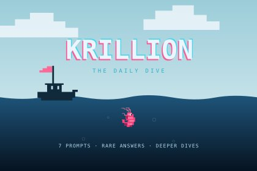

# Krillion — Cubes 2048

[在线体验 Krillion](https://cubes-2048.io/zh/games/krillion) · [项目网站：cubes-2048.io](https://cubes-2048.io) · [English](README.md)

Krillion 是一款寻找冷门答案的限时答题游戏。本仓库提供
[Cubes 2048](https://cubes-2048.io) 版本的独立源码、题库、素材、构建脚本和测试，
使用 React 与 TypeScript，无需账号、数据库或 API 密钥即可运行。

[](https://cubes-2048.io/zh/games/krillion)

## 本地运行

需要 Node.js 22+ 和 pnpm 10.15.0：

```sh
git clone https://github.com/ailingqu/krillion-game.git
cd krillion-game
corepack enable
pnpm install --frozen-lockfile
pnpm dev
```

打开 [localhost:4173](http://localhost:4173)，或直接访问
`/games/krillion/?lang=zh`。添加 `mode=unlimited` 参数可直接开始无限模式。
进度仅保存在当前浏览器和站点，不跨设备同步；清除网站数据会删除进度。

预览服务只监听本机 `127.0.0.1`，可用 `PORT=4174 pnpm preview` 更换端口。
修改源码后重新执行 `pnpm build`；此独立预览不提供热更新。

## 玩法与题库

- 55 个分类、2,836 道题目，包含字母和词长变化。
- 每局七轮，每轮 25 秒；最高 700 分 / 7,000 米。
- 答案分值固定，不使用实时玩家答题频率计分。
- 支持每日挑战、无限练习和六种主题挑战，每日挑战在 UTC 00:00 更新。
- 支持英文、简体中文、存档及挑战链接分享。

题库由仓库内的 `categories.txt` 编译生成。这是 Cubes 2048 独立维护的版本，
并非原游戏官方源码，题目、计分和存档相互独立，不调用原游戏服务。
[玩法参考](https://krillion.io/)。开源许可不授予第三方名称或商标的使用权。

## 构建与检查

```sh
pnpm typecheck
pnpm test
pnpm build
pnpm preview
```

测试前会自动构建，检查题库、计分、倒计时、存档、分享链接、独立资源和预览服务。
`public/` 包含可托管的静态文件及依赖许可；请部署到站点根目录，以支持
`/games/krillion/` 路径。仓库不自动创建线上部署。

`.game-previews/krillion-preview.html` 内嵌全部必需资源和许可说明，可单文件试玩。
生成文件不提交到 Git。游戏 HTML 保留 `noindex`，canonical 指向
[本站游戏页](https://cubes-2048.io/games/krillion)；发布其他品牌时请按实际情况调整。

## 贡献与许可

日常改动使用 `dev`，审核后的版本使用 `main`，提交前通过类型检查和测试。
问题可提交至 [GitHub Issues](https://github.com/ailingqu/krillion-game/issues)。

本站自有代码、素材和题库采用 [MIT](LICENSE)；第三方依赖保留各自许可，
Pixelify Sans 字体使用 SIL OFL 1.1，详见[第三方许可说明](THIRD_PARTY_NOTICES.md)。

更多在线游戏：**[cubes-2048.io](https://cubes-2048.io)**。
